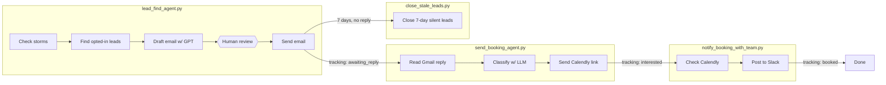
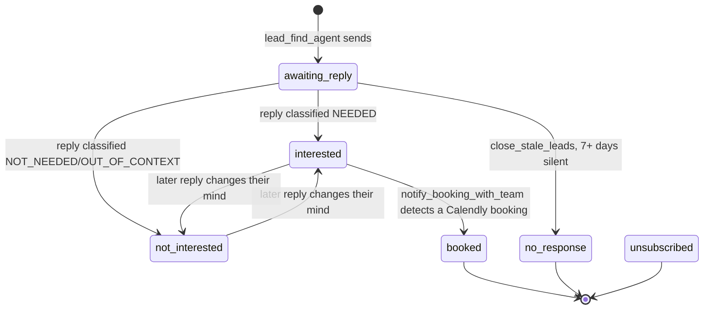

# StormLead Lead Engine

StormLead watches OpenWeather for storms across a roofing company's service
area, drafts a personalized outreach email to opted-in customers in any
affected city, holds every draft for human approval before it sends, then
carries an interested reply all the way through to a booked inspection --
triaging Gmail replies, sending a Calendly link, and alerting the team on
Slack the moment someone books.

It is four independent LangGraph pipelines plus one maintenance script, all
sharing one Postgres database as their coordination point, and one scheduler
that runs them unattended.

## Table of contents

- [Architecture](#architecture)
- [Repository layout](#repository-layout)
- [Prerequisites](#prerequisites)
- [Setup](#setup)
- [Configuration reference](#configuration-reference)
- [Running the pipeline manually](#running-the-pipeline-manually)
- [The human-review safety gate](#the-human-review-safety-gate)
- [Running unattended: scheduler.py](#running-unattended-schedulerpy)
- [Database schema](#database-schema)
- [External integrations](#external-integrations)
- [Operational notes](#operational-notes)
- [Production checklist](#production-checklist)

## Architecture

Four stages, each its own LangGraph graph and its own entry point script,
handed off to one another entirely through the `tracking` table's `status`
column -- no stage calls another directly.



Every write to `tracking.status` is the handoff. `send_booking_agent.py`
doesn't know or care that `lead_find_agent.py` was the one that sent the
original email -- it just polls every row that isn't in a terminal status.
That's what lets each stage run on its own schedule, independently, without
any of them holding state about the others in memory.

`tracking.status` moves through this lifecycle:



`booked`, `no_response`, and `unsubscribed` are terminal -- `send_booking_agent.py`'s
triage stops polling a thread once it lands in one of those. `unsubscribed`
is defined in the schema and reserved for a manual opt-out flow; no
automated job in this repo sets it today.

## Repository layout

```
.
├── mcp_client.py                  # shared MCP/Composio setup used by every agent
├── lead_find_agent.py             # storm -> leads -> draft -> human review -> send
├── send_booking_agent.py          # Gmail reply triage -> Calendly invite
├── notify_booking_with_team.py    # Calendly booking check -> Slack alert
├── close_stale_leads.py           # closes leads that went quiet for 7 days
├── scheduler.py                   # runs all four unattended, on their own cadence
├── mcp_servers/
│   └── weather_server.py          # custom stdio MCP server wrapping OpenWeather
├── db/
│   ├── schema.sql                 # customers / tracking / gmail_credentials DDL
│   └── generate_data.py           # synthetic customer + tracking seed data
├── main.py                        # placeholder entry point from `uv init`, unused
├── pyproject.toml / uv.lock       # dependencies (authoritative -- see Setup)
├── .env.example                   # env var template, copy to .env
└── README.md
```

`requirements.txt` is a stale, pre-`uv` artifact (references packages no
longer used, like `langchain-groq` and `fastapi`) -- `pyproject.toml` +
`uv.lock` are what's actually installed and maintained.

## Prerequisites

- **Python 3.12+** and [`uv`](https://docs.astral.sh/uv/)
- **PostgreSQL** (any reachable instance -- local, Docker, or hosted)
- Accounts/API keys for:
  - **OpenAI** -- email drafting, rewriting, reply classification, and the
    Calendly Tool Router agent
  - **OpenWeather** -- storm detection
  - **Klavis** -- hosted Gmail MCP server (send/read) and Slack MCP server
    (post message, list channels)
  - **Composio** -- Calendly Tool Router session (scheduling links, booking
    lookups)

## Setup

1. **Install dependencies**
   ```bash
   uv sync
   ```

2. **Configure environment**
   ```bash
   cp .env.example .env
   ```
   Fill in every value -- see [Configuration reference](#configuration-reference)
   for what each one is for. Every script calls `load_dotenv()` (directly,
   or transitively via `mcp_client.py`), so `.env` in the project root is
   picked up automatically.

3. **Provision the database**
   ```bash
   psql "$DATABASE_URL" -f db/schema.sql
   ```
   This creates `customers`, `tracking`, and `gmail_credentials`, and drops
   `customers`/`tracking` first if they already exist -- **it does not drop
   `gmail_credentials`**, so re-running it never disturbs a connected
   mailbox's stored token.

   For a real launch, populate `customers` from your actual CRM export
   instead of the generator below; `marketing_opt_in = true` is required for
   a customer to ever be targeted by `lead_find_agent.py`.

   To try the pipeline against synthetic data first:
   ```bash
   uv run python db/generate_data.py --customers 400 --seed 42
   ```
   Seeds customers across 10 storm-prone metros (Dallas, Houston, Austin,
   San Antonio, Denver, Colorado Springs, Tampa, Orlando, Miami,
   Jacksonville) plus a realistic distribution of `tracking` rows across
   every status. Each script's `ensure_*` function (`ensure_tracking_table`,
   `ensure_triage_columns`, `ensure_notify_columns`,
   `ensure_pending_review_table`) also idempotently creates/migrates
   whatever it needs on every run, so a fresh `schema.sql` isn't strictly
   required before first use -- just `DATABASE_URL` pointing at *some*
   Postgres database with a `customers` table.

## Configuration reference

| Variable | Required by | Purpose |
|---|---|---|
| `DATABASE_URL` | everything | Postgres connection string for `customers`/`tracking` and the LangGraph checkpointer |
| `OPENAI_API_KEY` | `lead_find_agent.py`, `send_booking_agent.py`, `mcp_client.py` | Drafting, rewriting, reply classification, Calendly Tool Router agent |
| `OPENWEATHER_API_KEY` | `mcp_servers/weather_server.py` | Live storm/wind conditions per city |
| `KLAVIS_GMAIL_MCP_URL` | `mcp_client.py` | Hosted Gmail MCP endpoint (send + read) |
| `KLAVIS_SLACK_MCP_URL` | `mcp_client.py` | Hosted Slack MCP endpoint (post + list channels) |
| `KLAVIS_MCP_TOKEN` | `mcp_client.py` | Bearer token for both Klavis endpoints |
| `COMPOSIO_API_KEY` | `mcp_client.py` | Composio Calendly Tool Router session |
| `COMPOSIO_USER_ID` | `mcp_client.py` | Which connected Calendly account the session uses |

Optional, auto-detected by LangChain/LangGraph if set (no code in this repo
reads them directly): `LANGSMITH_TRACING`, `LANGSMITH_API_KEY`,
`LANGSMITH_ENDPOINT`, `LANGSMITH_PROJECT` -- set these to get LangSmith
tracing on every graph run, useful for debugging drafts/classifications in
production.

## Running the pipeline manually

Each script is independently runnable from the project root.

```bash
# 1. Check for storms in the given cities, draft + review + send outreach
uv run python lead_find_agent.py Dallas Houston

# 2. Triage Gmail replies and send Calendly invites to newly-interested leads
#    (no args = scan every non-terminal tracking row; or scope to specific customers)
uv run python send_booking_agent.py
uv run python send_booking_agent.py 401 402

# 3. Check for new Calendly bookings and alert #leads-only on Slack
uv run python notify_booking_with_team.py

# 4. Close leads that have gone 7+ days without a reply (override the window in days)
uv run python close_stale_leads.py
uv run python close_stale_leads.py 14
```

`send_booking_agent.py` and `notify_booking_with_team.py` accept a list of
`customer_id`s to scope a run to specific leads -- useful for testing
against one inbox without touching the rest of the book. `lead_find_agent.py`
has no such scoping today: a city argument targets *every* opted-in
customer in that city, so test against a low-volume city or a database with
only test customers before pointing it at a real, fully-populated one.

## The human-review safety gate

`lead_find_agent.py` never sends an email without a human approving it
first. After drafting, the graph hits a LangGraph `interrupt()` inside the
`human_review` node and genuinely pauses -- checkpointed to Postgres, not
held in memory -- until a decision comes back for every pending draft:
**approve**, **reject**, or **rewrite** (with feedback, regenerated by the
LLM and sent back for another look).

Two ways to resolve a paused run:

- **Interactively, right away** -- running `lead_find_agent.py <city>`
  drafts and immediately prompts you in the terminal, draft by draft.
- **Later, separately** -- if a run pauses and nobody resolves it in that
  process (a scheduled run, or a terminal that got closed mid-review), its
  thread is recorded in `run_a_pending_review`. Resolve everything waiting,
  anytime, with:
  ```bash
  uv run python lead_find_agent.py --review
  ```

This is the one deliberate manual step in an otherwise fully automated
pipeline. It is not a limitation to work around -- treat it as the actual
control point for what gets sent to real customers, and check
`--review` regularly if `lead_find_agent.py` runs on a schedule.

## Running unattended: scheduler.py

```bash
uv run python scheduler.py
```

Runs all four stages on independent schedules, forever, until stopped
(Ctrl+C):

| Job | Cadence | Script |
|---|---|---|
| `lead_find_agent` | daily, 08:00 | `lead_find_agent.py` |
| `send_booking_agent` | every 30 min | `send_booking_agent.py` |
| `notify_booking_with_team` | every hour | `notify_booking_with_team.py` |
| `close_stale_leads` | daily, 08:30 | `close_stale_leads.py` |

Edit the `hour`/`minute`/`minutes`/`hours` kwargs on the `scheduler.add_job(...)`
calls in `scheduler.py` to change any of these. `lead_find_agent`'s job
sweeps `SERVICE_CITIES` (top of `scheduler.py`, defaults to the 10 metros
`db/generate_data.py` seeds) -- keep that list in sync with wherever your
real customers actually are.

The MCP client, every MCP tool, and the Postgres checkpointer are all built
**once** at process startup (`build_pipeline()`) and reused by every job --
rebuilding them per tick would mean a fresh Composio Calendly session (and
another open Postgres connection) every 30 minutes, forever. This also
means all four jobs share one long-lived process: run `scheduler.py` under
a process supervisor for production (systemd service, Docker with a
restart policy, NSSM/Task Scheduler on Windows, `pm2`, etc.) rather than
a bare terminal, so it comes back up after a crash or reboot.

`lead_find_agent`'s scheduled job never blocks on input, per the review
gate above -- it kicks off the run, and if it pauses, logs the thread id
and moves on. Check `lead_find_agent.py --review` on your own cadence
(daily, alongside the 08:00 job, is a reasonable default) to actually
approve and send what it drafted.

## Database schema

Full DDL in `db/schema.sql`; each script's `ensure_*` function also creates/
migrates its own pieces idempotently, so the schema below reflects the
*current* shape after all scripts have run at least once, not just the raw
file.

**`customers`** -- one row per customer/property. `marketing_opt_in` gates
whether `lead_find_agent.py` will ever target them; `roof_material` /
`roof_age_years` / `insurance_carrier` feed the email personalization.

**`tracking`** -- one row per outreach thread, the coordination point
described in [Architecture](#architecture). Key columns:

| Column | Written by | Meaning |
|---|---|---|
| `status` | all four agents | see the state diagram above |
| `thread_id` | `lead_find_agent.py` | Gmail thread id; also the DB row's identity for a given send |
| `storm_context` | `lead_find_agent.py` | JSONB snapshot of the storm that triggered this outreach |
| `processed_message_count` | `send_booking_agent.py` | last-seen Gmail message count on the thread, so a reply is never re-triaged |
| `nudge_count` | `send_booking_agent.py` | doubles as "has a Calendly invite been sent" (0 = not yet) |
| `triage_reason` | `send_booking_agent.py` | one-sentence LLM rationale for the interested/not_interested classification |
| `scheduled_at` | `notify_booking_with_team.py` | booked appointment time, once known |

**`run_a_pending_review`** -- ledger of `lead_find_agent.py` runs currently
paused at `human_review`, so `--review` (or a future dashboard) knows what's
waiting. Rows are removed the moment a run's drafts are all resolved.

**`gmail_credentials`** -- OAuth token storage for a connected mailbox.
Intentionally excluded from `schema.sql`'s `DROP TABLE` statements, so
reseeding `customers`/`tracking` via `generate_data.py` never disturbs a
connected account.

## External integrations

All MCP/Composio wiring lives in one place, `mcp_client.py`, and is shared
by every graph -- no other file talks to these services directly.

| Server | Transport | Tools used |
|---|---|---|
| `openweather` (`mcp_servers/weather_server.py`, this repo) | stdio | `get_current_weather` |
| `Klavis-strata` (hosted) | streamable HTTP | `gmail_send_email`, `gmail_read_email` |
| `Slack-mcp` (hosted, Klavis) | streamable HTTP | `slack_user_post_message`, `slack_user_list_channels` |
| `calendly-agent` (Composio Tool Router) | streamable HTTP | `COMPOSIO_SEARCH_TOOLS`, `COMPOSIO_GET_TOOL_SCHEMAS`, `COMPOSIO_MULTI_EXECUTE_TOOL` |

Calendly has no fixed MCP tools of its own here -- the Composio session
exposes a generic search → read-schema → execute router instead, so
`mcp_client.build_composio_calendly_agent()` wraps it in a small ReAct
agent (`run_composio_agent()`) that drives that loop itself, with a hard
90s timeout and a 12-step recursion limit so a stuck tool call fails fast
instead of hanging a graph run.

Slack posts go to a hardcoded channel name, `leads-only`
(`notify_booking_with_team.py`'s `SLACK_CHANNEL_NAME`) -- create that
channel in your workspace (or change the constant) before running
`notify_booking_with_team.py` for real.

## Operational notes

- **Windows + psycopg async**: Windows' default `ProactorEventLoop` can't
  run `psycopg`'s async mode. Every entry point's `if __name__ ==
  "__main__":` block selects `asyncio.SelectorEventLoop` on `win32` before
  calling `asyncio.run()`. Not needed on Linux/macOS (`loop_factory` is
  `None` there, i.e. the default).
- **Checkpointer connection lifetime**: `mcp_client.build_checkpointer()`
  keeps a module-level reference to the `AsyncPostgresSaver`'s context
  manager (`_checkpointer_cms`). Without it, the context manager object
  goes out of scope as soon as the function returns and gets
  garbage-collected -- which silently closes the underlying Postgres
  connection out from under every graph a few moments later. If you ever
  see `psycopg.OperationalError: the connection is closed` shortly after
  startup, check that whatever's calling `build_checkpointer()` isn't
  discarding its return value in a way that lets this happen again.
- **Logging**: `scheduler.py` uses its own non-propagating logger
  (`logging.getLogger("scheduler")`) rather than `logging.basicConfig()`,
  because some already-imported dependency (LangChain/MCP) attaches its own
  root handler first, which makes `basicConfig()` a silent no-op unless
  forced -- and forcing it would also turn on every third-party library's
  own INFO-level chatter (every httpx/MCP request) along with the
  scheduler's.

## Production checklist

- [ ] `db/schema.sql` applied against a real (not synthetic) `customers`
      table, `marketing_opt_in` accurate per customer
- [ ] All eight required env vars set (see
      [Configuration reference](#configuration-reference)) and `.env` is
      **not** committed
- [ ] `leads-only` Slack channel exists and the connected identity is a
      member of it
- [ ] Composio's Calendly connection is live and has a default/primary
      event type
- [ ] `scheduler.py`'s `SERVICE_CITIES` matches your real service area
- [ ] Ran at least one real end-to-end pass against a single test lead
      first (one real email, one real reply, one real booking) before
      pointing `lead_find_agent.py` at a fully populated city
- [ ] `scheduler.py` runs under a process supervisor, not a bare terminal
- [ ] Someone is actually checking `lead_find_agent.py --review` on a
      regular cadence -- a scheduled `lead_find_agent` run that drafts and
      is never reviewed just accumulates unsent leads forever
